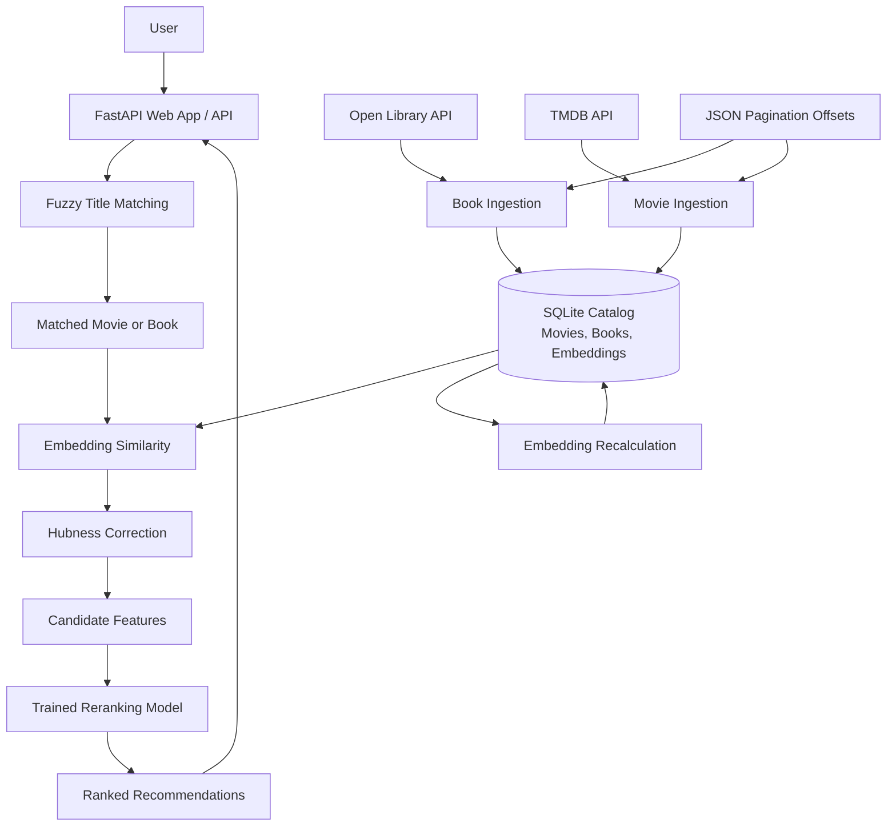

# REEL RIOT

**Find your next favorite book through a movie — or your next favorite movie through a book.**

REEL RIOT is a cross-media recommendation system that connects movies and books using semantic similarity and machine-learning reranking. Built with Python and FastAPI, it combines text embeddings, hubness correction, fuzzy title matching, and a trained model to discover meaningful relationships between different forms of media.

The project is under active development and is designed to run locally or on a self-hosted server.

## Demo

Demo assets are organized in `docs/images/`. Add screenshots or a GIF here using their actual filenames when you want to display them in the README.

## Features

- **Cross-media recommendations:** Discover books related to a movie and movies related to a book.
- **Semantic embeddings:** Represent media descriptions as numerical vectors using Sentence Transformers.
- **Hubness correction:** Adjust similarity scores to account for candidates that appear broadly similar across the catalog.
- **Fuzzy title matching:** Identify titles despite partial input or differences in wording using RapidFuzz.
- **Machine-learning reranking:** Reorder similarity-based candidates using a trained model and candidate features.
- **Catalog ingestion:** Retrieve book metadata from Open Library and movie metadata from TMDB.
- **Persistent pagination:** Track catalog progress using JSON offset files between ingestion runs.
- **Embedding maintenance:** Refresh stored embeddings after catalog updates.
- **Web interface and API:** Search for titles and request recommendations through a FastAPI application.

## How It Works

REEL RIOT follows a pipeline from title matching to ranked recommendations:

1. **Match the input title.** RapidFuzz compares the submitted title against titles in the movie and book catalogs.
2. **Identify the source item.** The application determines the matching title and its media type.
3. **Find candidates.** The system compares the source item's embedding with items in the opposite media category.
4. **Correct similarity scores.** Hubness correction adjusts the raw similarity scores.
5. **Rerank candidates.** The trained model evaluates candidate features to refine the recommendation order.
6. **Return results.** The API returns the matched source item and its ranked recommendations.

### Architecture



### Catalog Maintenance

The ingestion scripts are organized in `update-scripts/`. They retrieve metadata from Open Library and TMDB, while JSON offset files preserve pagination progress between runs.

After new records are added, their embeddings need to be generated or refreshed before they can be used reliably by the recommendation pipeline.

Embedding regeneration and recommendation-model training are separate operations. Refreshing embeddings does not automatically retrain the reranker.

## Technology Stack

| Area | Technologies |
|---|---|
| Backend | Python, FastAPI, Uvicorn |
| Frontend | HTML, CSS, JavaScript, Jinja2 |
| Database | SQLite |
| Text embeddings | Sentence Transformers |
| Numerical processing | NumPy, pandas |
| Title matching | RapidFuzz |
| Machine learning | scikit-learn, Joblib |
| Movie metadata | TMDB API |
| Book metadata | Open Library API |
| Dependency management | uv |

## Project Structure

The repository is organized into application code, frontend assets, package source, and catalog-maintenance scripts.

```text
REEL-RIOT/
├── docs/
│   └── images/             # README and project images
├── src/
│   └── mediarecs/          # Python package source
├── static/                 # CSS, JavaScript, and other static assets
├── templates/              # Jinja2 HTML templates
├── update-scripts/         # Catalog ingestion and maintenance scripts
├── .gitignore              # Git ignore rules
├── .python-version         # Project Python version
├── README.md               # Project documentation
├── app.py                  # FastAPI web application and API endpoints
├── model.py                # Model-related functionality
├── pyproject.toml          # Project configuration and dependencies
├── rec.py                  # Matching, similarity, and recommendation logic
├── reranker_model.pkl      # Trained recommendation reranker
└── uv.lock                 # Locked dependency versions
```

**Runtime files:** The application expects a compatible `media.db` SQLite database in the working directory used by `rec.py`. This database is not listed among the repository's root files, so you may need to create or supply it separately. The database must contain the expected tables and stored embeddings.

## Getting Started

### Prerequisites

- Python 3.14 or another version supported by `pyproject.toml`
- [uv](https://docs.astral.sh/uv/)
- A compatible SQLite database containing the required movie and book records and embeddings
- The trained `reranker_model.pkl` file, which is present in the repository
- A TMDB API key if you plan to ingest movie metadata

A fresh clone may not be immediately runnable without the required database. Ensure that the database schema and stored embeddings are compatible with the current recommendation code.

### 1. Clone the Repository

```bash
git clone https://github.com/justincox8/REEL-RIOT.git
cd REEL-RIOT
```

### 2. Install Dependencies

Install the dependencies specified by the project configuration:

```bash
uv sync
```

### 3. Prepare the Database

The recommendation code loads `media.db` and the trained `reranker_model.pkl` using relative paths. Run the application from the repository root and make sure the database exists there.

The database needs compatible `movies` and `books` tables, including the fields used by the recommendation code and stored embeddings.

If you do not already have a compatible database, inspect the scripts in `update-scripts/` before attempting to populate a new one.

### 4. Configure TMDB

If you plan to retrieve movie metadata, configure the TMDB API key expected by the ingestion script. For example, if the script reads `MOVIE_KEY` from a `.env` file, create a `.env` file in the repository root:

```dotenv
MOVIE_KEY=your_tmdb_api_key
```

Check the ingestion script for the exact environment variable it expects. Keep API credentials private, and do not commit `.env` or other secrets to Git.

### 5. Start the Application

From the repository root, run:

```bash
uv run uvicorn app:app --reload
```

Open the application at:

[http://127.0.0.1:8000](http://127.0.0.1:8000)

The `--reload` option is intended for development rather than production deployment.

## API Endpoints

The FastAPI application exposes endpoints for title search, cross-media recommendations, and health checks.

### `GET /api/search`

Search for a movie or book title.

| Parameter | Description |
|---|---|
| `q` | Title or partial title to search for; required |

Example:

```http
GET /api/search?q=animal%20farm
```

A successful match returns the query, whether a source was found, and information about the matched source, including its media type, title, and index. If no match is found, the response indicates that no source was identified.

### `GET /api/recommend`

Generate recommendations from the opposite media category.

| Parameter | Description |
|---|---|
| `q` | Movie or book title; required |
| `n` | Number of recommendations, from 1 to 10; defaults to 5 |

Example:

```http
GET /api/recommend?q=animal%20farm&n=5
```

A movie input produces book recommendations, while a book input produces movie recommendations.

The response includes the matched source and a list of recommendations. If no source is found, the recommendations list is empty.

### `GET /health`

Check whether the API is responding.

```http
GET /health
```

Example response:

```json
{
  "status": "ok"
}
```

## Catalog Updates and Embeddings

Catalog-maintenance scripts are located in `update-scripts/`, rather than in the repository root.

### Data Ingestion

The project uses Open Library for book metadata and TMDB for movie metadata. The ingestion scripts and their pagination state files are organized under `update-scripts/`.

Before running an ingestion script:

1. Configure any required API credentials.
2. Confirm the database path and expected schema.
3. Check the script's pagination settings and output.
4. Verify that existing records are handled correctly.

Pagination offsets help maintain progress between runs, but they do not guarantee that every upstream title will be collected exactly once. Catalog ordering can change, and records may be encountered more than once.

### Recalculate Embeddings

After adding new media, regenerate embeddings using the embedding-maintenance script provided in `update-scripts/`.

Check the directory for the script's current filename and run it from the repository root if it uses relative paths. Confirm which database tables it updates before running it.

Embedding recalculation refreshes stored vectors. It does not necessarily retrain the reranker or regenerate separate ranking data.

### Run the Update Workflow

The catalog-update workflow is organized under `update-scripts/`. Inspect the scripts in that directory to confirm the current entry point and execution order before running the workflow.

For example, if the update script is named `update.sh`, run:

```bash
bash update-scripts/update.sh
```

Review the script before executing it. If it contains a hard-coded working directory, change that path to match your local checkout.

## Current Limitations

- **Database setup:** A compatible SQLite database is required, but it is not listed among the repository's root files.
- **Runtime compatibility:** The database schema, embeddings, and trained reranker must match the current code.
- **Catalog coverage:** Pagination can encounter duplicates or skip titles when upstream catalog results change.
- **Ranking maintenance:** New records need embeddings, and any separately maintained training data may require its own refresh.
- **Deployment:** The project is primarily structured for local development; a complete production deployment process is not documented here.
- **Evaluation:** Recommendation quality and catalog coverage can be evaluated and improved further.

## Roadmap

- [ ] Add screenshots and a short demonstration using the actual files in `docs/images/`.
- [ ] Document a reproducible database initialization process.
- [ ] Make catalog-update scripts configurable across machines.
- [ ] Automate recurring catalog maintenance.
- [ ] Add evaluation metrics and examples for recommendation quality.
- [ ] Document a deployment path for self-hosting or a public demo.

## Acknowledgments

- [Open Library](https://openlibrary.org/) for book metadata.
- [The Movie Database (TMDB)](https://www.themoviedb.org/) for movie metadata.
- [Sentence Transformers](https://www.sbert.net/) for text embeddings.
- [FastAPI](https://fastapi.tiangolo.com/) for the web framework.
- [RapidFuzz](https://github.com/rapidfuzz/RapidFuzz) for fuzzy title matching.
- [uv](https://docs.astral.sh/uv/) for Python dependency management.

---

**REEL RIOT** — because your next favorite book might already be hiding in your favorite movie.
