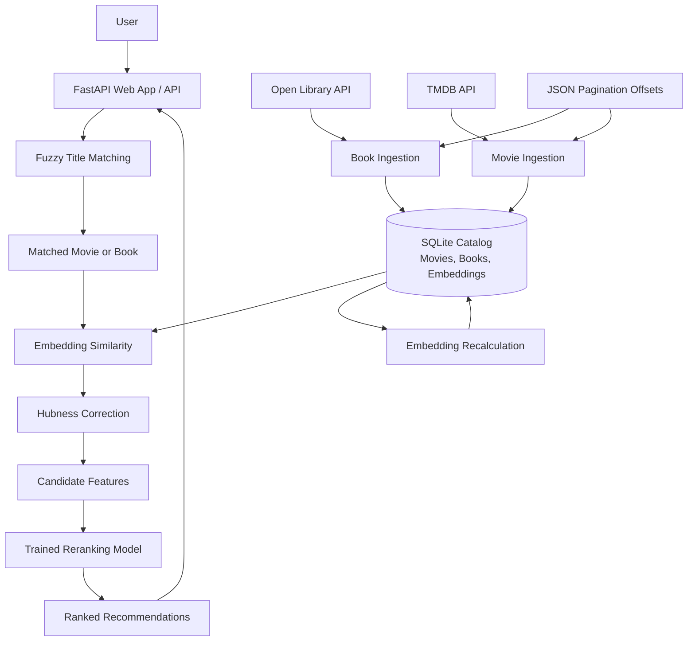

# REEL RIOT

**Find your next favorite book through a movie — or your next favorite movie through a book.**

REEL RIOT is a cross-media recommendation system that connects movies and books using semantic similarity and machine-learning reranking. It combines text embeddings, hubness correction, fuzzy title matching, and a trained ranking model to find meaningful connections across media.

The project is under active development and is intended to run locally or on a self-hosted server.

## Demo


## Features

- **Cross-media recommendations:** Discover books related to a movie and movies related to a book.
- **Semantic search:** Use Sentence Transformers embeddings to represent media descriptions as vectors.
- **Hubness correction:** Adjust similarity scores to reduce the influence of candidates that appear similar to many items.
- **Fuzzy title matching:** Find titles from partial or slightly different input with RapidFuzz.
- **Machine-learning reranking:** Refine the initial candidate order using a trained model and candidate features.
- **Catalog ingestion:** Fetch book metadata from Open Library and movie metadata from TMDB.
- **Incremental updates:** Store pagination progress in JSON offset files between ingestion runs.
- **Embedding refresh:** Recalculate embeddings when the catalog changes.
- **Web app and API:** Use the FastAPI application to search titles and request recommendations.

## How It Works

REEL RIOT follows a pipeline from title matching to ranked recommendations:

1. **Match the input title.** RapidFuzz compares the submitted title with titles in the catalog.
2. **Identify the source item.** The application determines the matching title and whether it is a movie or a book.
3. **Find candidates.** The system compares the source item's embedding with items in the opposite media category.
4. **Adjust similarity scores.** Hubness correction modifies the raw similarity scores.
5. **Rerank candidates.** The trained model uses candidate features to refine the recommendation order.
6. **Return recommendations.** The API returns the matched source item and the ranked results.

### Architecture



### Catalog Maintenance

The ingestion scripts fetch metadata from Open Library and TMDB. JSON offset files preserve pagination progress between runs. After adding records, the embedding recalculation script refreshes stored vectors.

Embedding regeneration and recommendation-model training or ranking-data regeneration are separate operations; refreshing embeddings does not automatically retrain the reranker.

## Technology Stack

| Area | Technologies |
|---|---|
| Backend | Python, FastAPI, Uvicorn |
| Frontend | HTML, CSS, JavaScript, Jinja2 |
| Database | SQLite |
| Text embeddings | Sentence Transformers, `all-mpnet-base-v2` |
| Numerical processing | NumPy, pandas |
| Title matching | RapidFuzz |
| Machine learning | scikit-learn, Joblib |
| Movie metadata | TMDB API |
| Book metadata | Open Library API |
| Dependency management | uv |

## Getting Started

### Prerequisites

- Python version supported by the project configuration
- [uv](https://docs.astral.sh/uv/)
- A compatible SQLite database containing the expected tables and embeddings
- The trained `reranker_model.pkl` file
- A TMDB API key if you plan to ingest movie metadata

**Important:** A fresh clone may not include a ready-to-use database or trained model. The database schema, stored embeddings, and model file must be compatible with the current code.

### 1. Clone the Repository

```bash
git clone https://github.com/justincox8/REEL-RIOT.git
cd REEL-RIOT
```

If the repository's directory or default branch differs, use the clone URL and directory shown on the GitHub page.

### 2. Install Dependencies

```bash
uv sync
```

### 3. Prepare Runtime Files

Place a compatible `media.db` in the location expected by the application and ensure it contains the required movie and book records, embedding columns, and any other columns used by the recommendation pipeline.

Make the compatible `reranker_model.pkl` available at the path expected by the code. Check the database and model paths in the application before starting it.

### 4. Configure TMDB (for Movie Ingestion)

Create a `.env` file in the project root:

```dotenv
MOVIE_KEY=your_tmdb_api_key
```

Keep API credentials private. Do not commit `.env` or other secrets to Git.

### 5. Start the Application

From the repository root, run:

```bash
uv run uvicorn app:app --reload
```

Then open [http://127.0.0.1:8000](http://127.0.0.1:8000).

The `--reload` option is intended for development, not production deployment. If the application entry point or ASGI object has a different name in the current checkout, adjust the command accordingly.

## API Endpoints

The following endpoints describe the current documented API. Confirm them against `app.py` if the implementation changes.

### `GET /api/search`

Search for a movie or book title.

| Parameter | Description |
|---|---|
| `q` | Full or partial title to search for |

Example:

```http
GET /api/search?q=animal%20farm
```

A successful response identifies the matched title, its media type, and its source index. If no title matches, the response indicates that no source item was found.

### `GET /api/recommend`

Get recommendations from the opposite media category.

| Parameter | Description |
|---|---|
| `q` | Movie or book title |
| `n` | Number of recommendations; defaults to `5`, with a documented maximum of `10` |

Example:

```http
GET /api/recommend?q=animal%20farm&n=5
```

A movie input returns book recommendations; a book input returns movie recommendations.

### `GET /health`

Check whether the API is responding.

```http
GET /health
```

Example response:

```json
{
  "status": "ok"
}
```

## Catalog Updates and Embeddings

### Ingest New Records

The project includes ingestion scripts for its supported metadata sources:

- `populate_books.py` retrieves books from Open Library.
- `populate_movies.py` retrieves movies from TMDB.

The scripts use JSON files to track pagination progress. Existing records may be skipped when they conflict with database uniqueness constraints, so the number of new records can be lower than the number fetched.

Offsets do not guarantee complete, duplicate-free collection because upstream catalog ordering and availability can change.

### Recalculate Embeddings

After adding records, run:

```bash
uv run python recalc.py
```

The script refreshes embeddings for the configured media tables. Check the script before running it to confirm which tables it updates and which model it uses.

Embedding recalculation updates stored vectors; it does not necessarily retrain the reranker or regenerate separate ranking data.

### Run the Update Script

If `update.sh` is present and configured for your machine, run:

```bash
bash update.sh
```

The update workflow is intended to ingest records and recalculate embeddings. Review the script before running it: if it contains a hard-coded directory, change that path to match your checkout.

## Project Structure

The exact structure may evolve. The main components described by this project include:

```text
REEL-RIOT/
├── app.py                 # FastAPI application
├── rec.py                 # Matching and recommendation logic
├── model.py               # Model-related functionality
├── recalc.py              # Embedding recalculation
├── populate_books.py      # Open Library ingestion
├── populate_movies.py     # TMDB ingestion
├── update.sh              # Catalog update workflow
├── book_offsets.json      # Book pagination progress
├── movie_offsets.json     # Movie pagination progress
├── reranker_model.pkl     # Trained reranking model
├── media.db               # Local SQLite catalog
├── pyproject.toml         # Project configuration and dependencies
├── uv.lock                # Locked dependency versions
├── templates/             # Jinja2 templates
├── static/                # Frontend assets
└── docs/images/           # README screenshots and demo media
```

Treat this as a guide, not a guarantee that every listed file is present in every checkout. Check the repository for the current layout before relying on a particular path.

## Current Limitations

- **Runtime assets:** The application depends on a compatible database and trained model.
- **Setup:** A fresh clone may require manual preparation of the database and model files.
- **Catalog coverage:** Incremental pagination can still miss or encounter duplicate items when upstream results change.
- **Ranking maintenance:** New records need embeddings, and any separately maintained training or ranking data may require its own refresh process.
- **Deployment:** The setup and deployment workflow is still being developed.
- **Evaluation:** Recommendation quality and catalog coverage need continued testing.

## Roadmap

- [ ] Add and maintain screenshots and a short demo.
- [ ] Document a reproducible database initialization process.
- [ ] Make update scripts configurable across machines.
- [ ] Automate recurring catalog maintenance.
- [ ] Add evaluation metrics and examples for recommendation quality.
- [ ] Document a deployment path for self-hosting or a public demo.

## Acknowledgments

- [Open Library](https://openlibrary.org/) for book metadata.
- [The Movie Database (TMDB)](https://www.themoviedb.org/) for movie metadata.
- [Sentence Transformers](https://www.sbert.net/) for text embeddings.
- [FastAPI](https://fastapi.tiangolo.com/) for the web framework.
- [RapidFuzz](https://github.com/rapidfuzz/RapidFuzz) for fuzzy title matching.
- [uv](https://docs.astral.sh/uv/) for Python dependency management.

---

**REEL RIOT** — because your next favorite book might already be hiding in your favorite movie.
