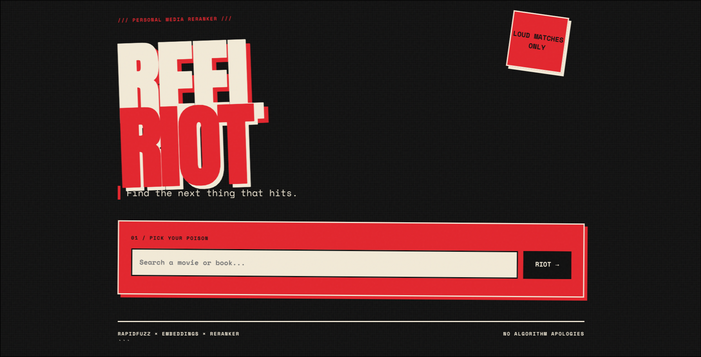
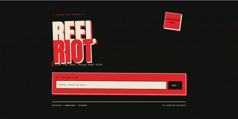
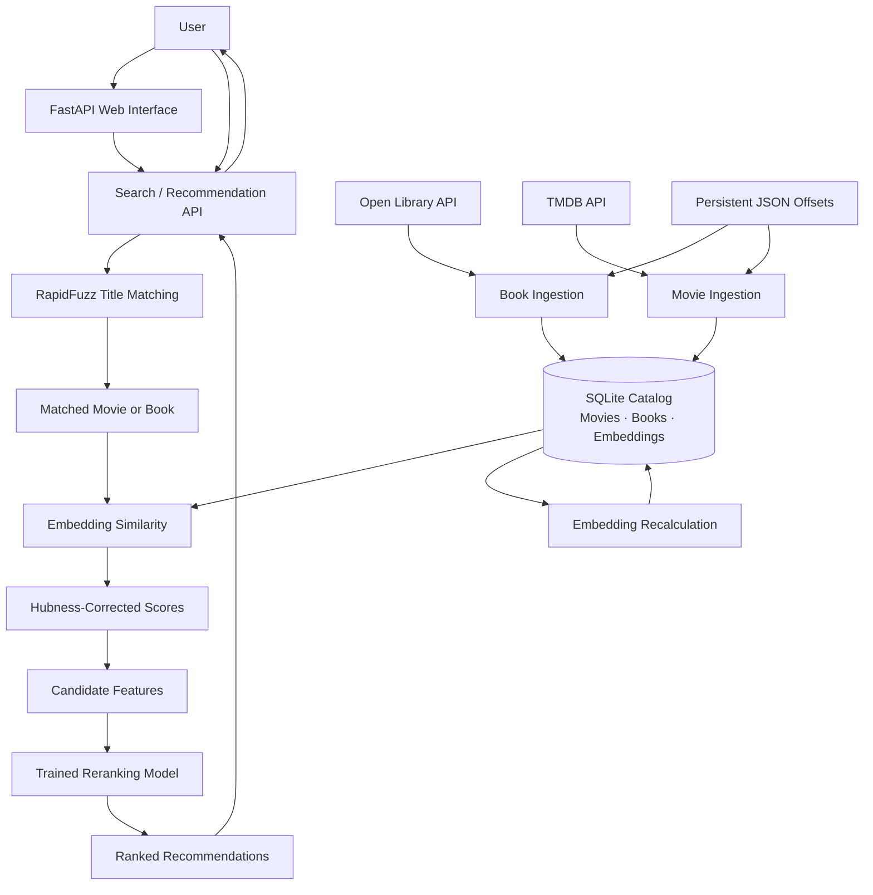

# REEL RIOT

**Find your next favorite book through a movie — or your next favorite movie through a book.**

REEL RIOT is a cross-media recommendation system that connects movies and books using semantic similarity and machine-learning reranking. Built with Python and FastAPI, it combines natural-language embeddings, hubness correction, fuzzy title matching, and a trained model to discover relationships between different forms of media.

The project is currently in active development and is designed to run locally or on a self-hosted server.

## Demo





*Screenshots and a short demo GIF will be added here.*

## Features

- **Cross-media discovery:** Find books related to a movie and movies related to a book.
- **Semantic embeddings:** Represent media descriptions as numerical vectors using Sentence Transformers.
- **Hubness correction:** Adjust similarity scores to account for candidates that appear broadly similar across the catalog.
- **Fuzzy title matching:** Identify titles despite partial input or differences in wording using RapidFuzz.
- **Machine-learning reranking:** Reorder similarity-based candidates using a trained model and candidate features.
- **Incremental catalog ingestion:** Retrieve books from Open Library and movies from TMDB by subject or genre.
- **Persistent pagination:** Track catalog progress in JSON offset files between ingestion runs.
- **Embedding maintenance:** Recalculate stored embeddings after catalog updates.
- **Web interface and API:** Search for titles and request recommendations through a FastAPI application.

## Architecture

The application separates the user-facing API, recommendation pipeline, persistent catalog, and data-ingestion workflow.



### Recommendation pipeline

1. **Match the input:** RapidFuzz compares the supplied title against the available movie and book catalogs.
2. **Load the source item:** The system identifies the matching title and its media type.
3. **Compare embeddings:** The recommendation pipeline compares the source item's embedding against candidates in the opposite media category.
4. **Correct similarity scores:** Hubness correction adjusts the raw similarity scores.
5. **Rerank candidates:** The trained model evaluates candidate features to produce the final recommendation order.
6. **Return results:** The API returns the matched source and ranked recommendations.

### Catalog maintenance pipeline

The ingestion scripts retrieve additional metadata from Open Library and TMDB. Persistent offsets allow subsequent runs to continue from the previously recorded position. The embedding recalculation script then refreshes the stored vectors for the catalog.

Embedding regeneration and recommendation-ranking regeneration are separate operations.

## Technology Stack

| Area | Technologies |
|---|---|
| Backend | Python, FastAPI, Uvicorn |
| Frontend | HTML, CSS, JavaScript, Jinja2 |
| Database | SQLite |
| Embeddings | Sentence Transformers, `all-mpnet-base-v2` |
| Similarity and numerical processing | NumPy, pandas |
| Title matching | RapidFuzz |
| Machine learning | scikit-learn, Joblib |
| Movie metadata | TMDB API |
| Book metadata | Open Library API |
| Dependency management | uv |

## Project Structure

```text
mediarec/
├── app.py                 # FastAPI application and API endpoints
├── rec.py                 # Matching, similarity, and recommendation logic
├── model.py               # Additional model-related functionality
├── recalc.py              # Embedding regeneration
├── populate_books.py      # Open Library ingestion
├── populate_movies.py     # TMDB ingestion
├── update.sh              # Catalog update pipeline
├── book_offsets.json      # Book pagination progress
├── movie_offsets.json     # Movie pagination progress
├── reranker_model.pkl     # Trained reranking model
├── songs.csv              # Song metadata
├── media.db               # Local SQLite catalog; required at runtime
├── pyproject.toml         # Project configuration and dependencies
├── uv.lock                # Locked dependency versions
├── requirements.txt       # Alternative dependency list
├── src/mediarecs/         # Python package source
├── templates/             # Jinja2 HTML templates
└── static/                # CSS and frontend assets
```

The database and trained model are runtime dependencies. A fresh clone should not be assumed to contain a ready-to-use catalog.

## Getting Started

### Prerequisites

- Python 3.14 or a version supported by the current project configuration
- [uv](https://docs.astral.sh/uv/)
- A compatible SQLite database containing the expected tables and embeddings
- The trained `reranker_model.pkl` file

A TMDB API key is additionally required to run the movie ingestion script.

### 1. Clone the repository

```bash
git clone https://github.com/justincox8/mediarec.git
cd mediarec
```

### 2. Install dependencies

```bash
uv sync
```

### 3. Prepare the runtime files

Place a compatible `media.db` in the project root. Ensure it contains the expected movie and book records, embedding columns, and any additional columns required by the recommendation pipeline.

Make the compatible `reranker_model.pkl` available at the path expected by `rec.py`.

The application is not yet a self-contained, out-of-the-box deployment: the database schema, stored embeddings, and trained model must be compatible with the current code.

### 4. Configure TMDB access

Create a `.env` file in the project root if you intend to fetch movie metadata:

```dotenv
MOVIE_KEY=your_tmdb_api_key
```

Keep API credentials private and do not commit `.env` to Git.

### 5. Start the application

From the repository root, run:

```bash
uv run uvicorn app:app --reload
```

Open the local application at:

[http://127.0.0.1:8000](http://127.0.0.1:8000)

The `--reload` flag is intended for development.

## API Endpoints

### `GET /api/search`

Find a matching movie or book title.

| Parameter | Description |
|---|---|
| `q` | Title or partial title to search for |

Example:

```http
GET /api/search?q=animal%20farm
```

A successful match includes the media type, title, and source index. If no match is found, the response indicates that no source was identified.

### `GET /api/recommend`

Generate recommendations from the opposite media category.

| Parameter | Description |
|---|---|
| `q` | Movie or book title |
| `n` | Number of recommendations, from 1 to 10; defaults to 5 |

Example:

```http
GET /api/recommend?q=animal%20farm&n=5
```

A movie input produces book recommendations; a book input produces movie recommendations.

### `GET /health`

Check whether the API is responding.

```http
GET /health
```

Example response:

```json
{
  "status": "ok"
}
```

## Catalog Updates and Embeddings

### Data ingestion

The project uses two ingestion scripts:

- `populate_books.py` retrieves books by subject from Open Library.
- `populate_movies.py` retrieves movies by genre from TMDB.

The scripts use persistent JSON files to track pagination progress between runs. Existing database records are ignored when they conflict with the database's uniqueness constraints.

The current ingestion configuration targets approximately 100 fetched book records and 100 fetched movie records per run. The number of newly inserted records can be lower because previously stored records may be encountered again.

Because upstream catalog ordering can change, offsets do not guarantee that every title will be collected exactly once.

### Recalculate embeddings

After adding new media, run:

```bash
uv run python recalc.py
```

The script regenerates embeddings for the movie, book, and song tables using the configured Sentence Transformer model.

Recalculation refreshes stored embeddings; it does not automatically regenerate any separately stored recommendation rankings or training data.

### Update script

The repository includes `update.sh`, which runs these operations in sequence:

1. Update the book catalog.
2. Update the movie catalog.
3. Recalculate embeddings.

Run it manually with:

```bash
bash update.sh
```

**Deployment note:** The current script contains a hard-coded working directory. Update that path to match your checkout before running it on another machine. A recurring schedule also needs to be configured separately.

## Current Limitations

- **Local runtime assets:** The application depends on a compatible database and trained model.
- **Deployment:** Public hosting and a self-contained setup process are not yet provided.
- **Catalog freshness:** Pagination offsets help with incremental collection but cannot eliminate duplicates or skipped titles when upstream results change.
- **Ranking maintenance:** New catalog entries need embeddings, and any required precomputed rankings must be refreshed separately.
- **Development status:** Recommendation quality, catalog coverage, and deployment workflows remain areas for further development.

## Roadmap

- [ ] Add screenshots and a short animated demonstration.
- [ ] Make local setup reproducible with a documented database initialization process.
- [ ] Make update scripts configurable across machines.
- [ ] Automate recurring catalog maintenance.
- [ ] Improve recommendation evaluation and ranking features.
- [ ] Explore a low-cost public demo or self-hosted deployment guide.

## Acknowledgments

- [Open Library](https://openlibrary.org/) for book metadata.
- [The Movie Database (TMDB)](https://www.themoviedb.org/) for movie metadata.
- [Sentence Transformers](https://www.sbert.net/) for text embeddings.
- [FastAPI](https://fastapi.tiangolo.com/) for the web application framework.
